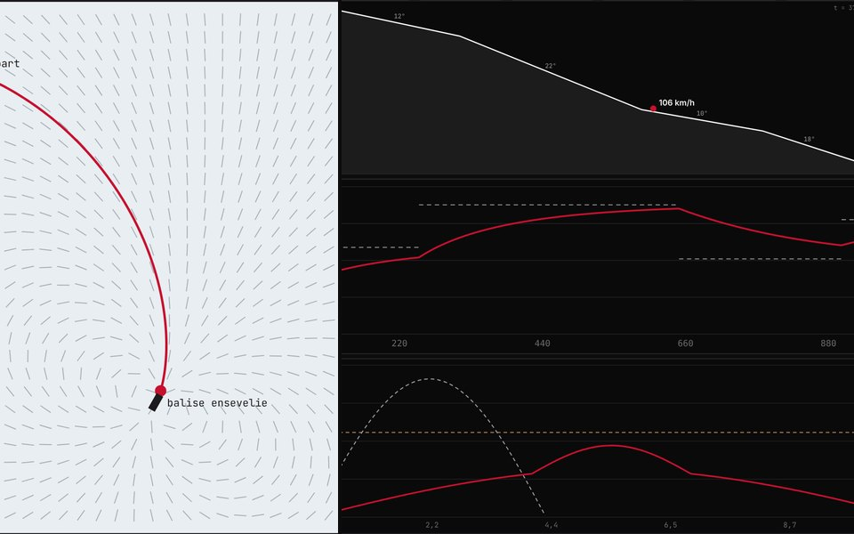

# Ski et snowboard : physique de la glisse et prévention des blessures

🇫🇷 [Français](#français) · 🇬🇧 [English](#english)

**Essayer la démo :** https://valentin-auger-laboratoire.github.io/portfolio/outils/sports-hiver/

> ⚠️ Modèles simplifiés et seuils de lésion **illustratifs** (ordres de grandeur de la littérature). Ce n'est **pas un outil médical**. **Ne réglez jamais vos fixations avec cet outil** : c'est le rôle d'un technicien certifié (norme ISO 11088). L'outil ne calcule volontairement aucun réglage personnel.

---

## Français

### L'idée
J'aime le ski et le snowboard, et je suis en école d'ingénieurs orientée santé (EPISEN). J'en ai fait un projet qui part de la physique, puis s'intéresse à ce qui blesse et à ce qui protège. Chaque partie est un modèle physique calculé et vérifié par des tests.

### Les 7 onglets
1. **Glisse et virage**
   - Descente en ligne droite avec frottement de la neige, traînée de l'air et densité de l'air selon l'altitude. L'intégration RK4 est vérifiée contre la solution exacte v_t·tanh.
   - Pistes verte, bleue, rouge et noire, pour un skieur debout, un skieur en position de recherche de vitesse ou un snowboardeur.
   - L'énergie d'un choc est ramenée à une hauteur de chute : 50 km/h correspondent à 9,8 m.
   - Virage coupé : R = R_sc·cos θ (formule de Howe) et sin θ = v²/(g·R_sc). On ne peut donc pas tourner sans déraper au-delà de √(g·R_sc) : environ 44 km/h pour un ski de 16 m, 32 km/h pour un snowboard de 8 m.
2. **Genou et fixation**
   - Torsion à un degré de liberté : le ski et la chaussure, la fixation élastique en série avec la jambe, un seuil de déclenchement réglable.
   - Quatre situations : virage normal, carre qui accroche, chute lente, choc très bref (filtré par l'inertie du ski). On y voit aussi l'amplification dynamique.
   - Limite rappelée : les fixations protègent peu le ligament croisé antérieur (mécanisme du « pied fantôme »).
3. **Poignet (snowboard)** : chute sur la main tendue, modélisée par une masse et des ressorts en série. Comparaison entre neige poudreuse, damée et glacée, avec ou sans protège-poignet (mousse à plateau), face à un seuil de fracture indicatif.
4. **Tête et casque**
   - Mousse EPS à contrainte de plateau, avec aire de contact d'une calotte sphérique, en série avec la surface d'impact.
   - Calcul du HIC sur 15 ms et du risque AIS ≥ 3 (courbe de Prasad et Mertz, reprise par la NHTSA).
   - Le test de la norme EN 1077 (5,42 m/s, 250 g) est réussi, mais à grande vitesse la mousse arrive à densification et le casque ne suffit plus.
5. **Avalanche et DVA**
   - Champ de dipôle magnétique de la balise, recherche en suivant les lignes de champ (un clic sur la carte place le sauveteur).
   - La distance affichée par le DVA est surestimée jusqu'à ×1,26 sur le côté de la balise.
   - Durée du sauvetage : premier signal, suivi des lignes de champ, localisation fine, sondage, pelletage.
   - Courbe de survie d'après Brugger et al. (2001).
6. **Froid** : indice de refroidissement éolien (JAG/TI 2001, Environnement Canada) en ajoutant la vitesse du skieur au vent, avec les catégories de risque de gelure.
7. **Vérifications** : contrôles recalculés en direct dans le navigateur.

### Fichiers
| Fichier | Contenu |
|---|---|
| `demo/hiver.js` | moteur : glisse, virage, torsion, impacts, HIC, dipôle, survie, refroidissement éolien |
| `demo/index.html` | interface de la démo |
| `demo/tests/test.js` | 470 vérifications : `node demo/tests/test.js` |

### Limites
- Descente en schuss : en réalité, on freine en enchaînant les virages.
- Virage coupé idéal, sur le plat.
- Impacts à un degré de liberté.
- Raideurs et seuils de lésion indicatifs : ils varient beaucoup selon les personnes.
- Durées de sauvetage : ordres de grandeur.

Sources : formule JAG/TI du refroidissement éolien (2001) ; courbe HIC → AIS ≥ 3 de Prasad et Mertz (NHTSA) ; survie en avalanche d'après Brugger et al. (2001) ; norme EN 1077 pour le test des casques de ski.

---

## English

### The idea
I love skiing and snowboarding, and I study at a health-oriented engineering school (EPISEN). I turned them into a project that starts with the physics, then looks at what injures and what protects. Each part is a physical model, computed and checked by tests.

### The 7 tabs
1. **Gliding and turns**
   - Straight descent with snow friction, air drag and air density versus altitude. The RK4 integration is checked against the exact v_t·tanh solution.
   - Green, blue, red and black runs, for an upright skier, a skier in tuck position or a snowboarder.
   - Impact energy as an equivalent fall height: 50 km/h equals 9.8 m.
   - Carved turn: R = R_sc·cos θ (Howe's formula) and sin θ = v²/(g·R_sc). You therefore cannot turn without skidding above √(g·R_sc): about 44 km/h for a 16 m ski, 32 km/h for an 8 m snowboard.
2. **Knee and binding**
   - One-degree-of-freedom torsion: ski and boot, an elastic binding in series with the leg, an adjustable release threshold.
   - Four situations: normal turn, edge catch, slow fall, very short shock (filtered by the ski's inertia). Dynamic amplification is also shown.
   - Stated limit: bindings do little for the anterior cruciate ligament ("phantom foot" mechanism).
3. **Wrist (snowboard)**: fall on the outstretched hand, modelled as a mass and springs in series. Powder, groomed and icy snow are compared, with or without a wrist guard (plateau foam), against an indicative fracture threshold.
4. **Head and helmet**
   - EPS foam with a plateau stress and the contact area of a spherical cap, in series with the impact surface.
   - 15 ms HIC and AIS ≥ 3 risk (Prasad and Mertz curve, used by NHTSA).
   - The EN 1077 test (5.42 m/s, 250 g) is passed, but at high speed the foam densifies and the helmet is no longer enough.
5. **Avalanche and transceiver**
   - Magnetic dipole field of the transmitter, search following field lines (a click on the map places the rescuer).
   - The distance shown by the transceiver is overestimated by up to ×1.26 on the side of the transmitter.
   - Rescue duration: first signal, following field lines, fine search, probing, shovelling.
   - Survival curve after Brugger et al. (2001).
6. **Cold**: wind chill index (JAG/TI 2001, Environment Canada), adding the skier's speed to the wind, with frostbite risk categories.
7. **Checks**: checks recomputed live in the browser.

### Files
| File | Contents |
|---|---|
| `demo/hiver.js` | engine: gliding, turns, torsion, impacts, HIC, dipole, survival, wind chill |
| `demo/index.html` | demo interface |
| `demo/tests/test.js` | 470 checks: `node demo/tests/test.js` |

### Limits
- Straight descent: in reality you brake by linking turns.
- Ideal carved turn, on flat ground.
- One-degree-of-freedom impacts.
- Stiffnesses and injury thresholds are indicative: they vary a lot between people.
- Rescue durations: orders of magnitude.

**Not a medical tool. Never set your bindings with it.**

---

[← Retour au portfolio / Back to the portfolio](https://valentin-auger-laboratoire.github.io/portfolio/)
